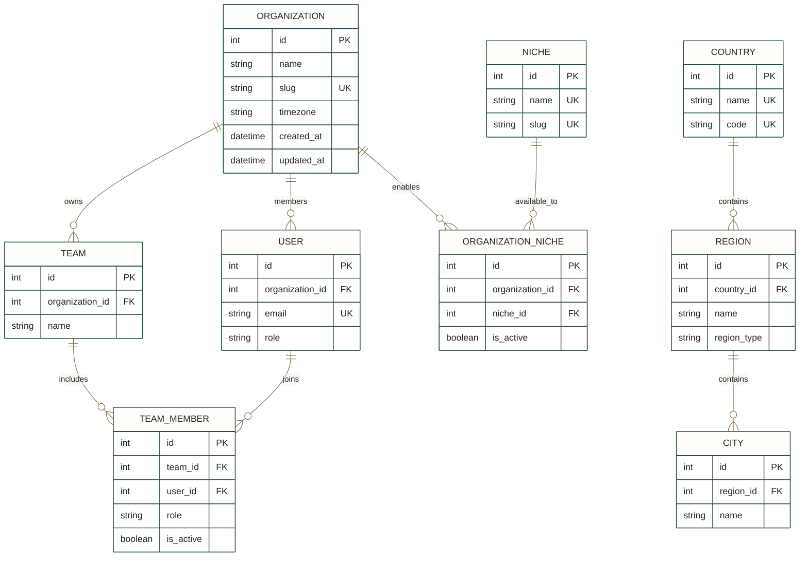
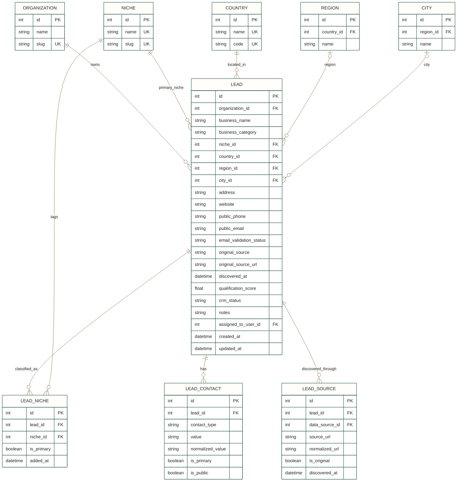
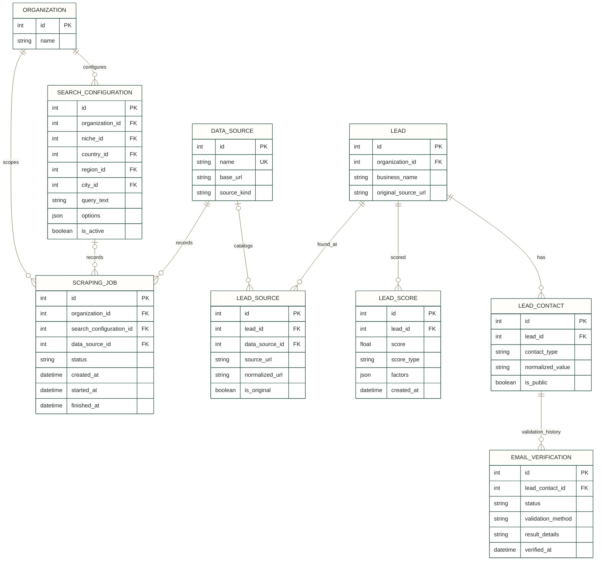
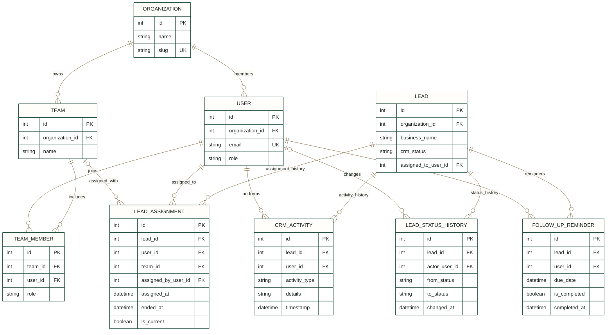
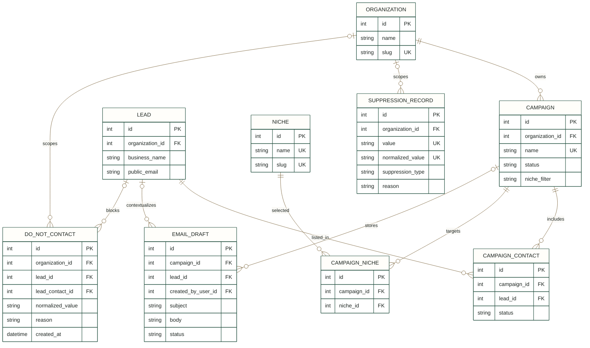

# Phase 2"éÝyø§yÔ database and core models

These focused Mermaid ER diagrams cover the Phase 2 relational model. The palette follows the Business Automation Labs website: warm ivory paper, forest green table headers, restrained gold relationship lines, and the existing system sans-serif stack.

## 1. Organization, access, niches, and geography

## 2. Leads, multiple niches, contacts, and retained sources

The original source URL stays on the lead and in source history. Additional niche selections add links; changing a selected niche is a filter operation and does not delete a lead.

## 3. Search configuration, discovery records, validation, and scores

Search configurations and scraping jobs are metadata only in this phase. They do not invoke a scraper, external data provider, or paid API. Email validation rows record manual, syntax-only, or imported outcomes; no verification service is configured.

## 4. Assignments, team history, activity, status changes, and reminders

The status helper writes the status and its history/activity record together in the caller's transaction. Assignments retain previous owners and mark one current assignment.

## 5. Campaign lists, drafts, suppression, and do-not-contact

Email drafts are stored with status `draft`; there is no sender or send job in this phase. Suppression and do-not-contact records are data controls and do not connect to a mailing service.

## Data integrity notes

- New lead writes use an organization ID. Existing Phase 1 rows retain a nullable organization link until assigned to a real organization; migration does not invent one.
- A lead keeps a primary niche for compatibility and may link to multiple niches through `lead_niches`. Filtering does not delete or retag historical leads.
- The source URL on the lead preserves the first recorded source. `lead_sources` stores additional discovery URLs, normalized for duplicate detection.
- Duplicate matching is organization-scoped. It uses normalized business names, public contact values, website host, and geographic IDs; a partial unique index prevents duplicate fingerprints where organization mapping is known.
- Country, region, and city IDs have foreign keys. The write service checks that a region belongs to its country and a city belongs to its region.
- Timestamp defaults are UTC. Existing legacy timestamps are interpreted as UTC; ORM values round-trip as timezone-aware UTC.
- SQLite foreign keys are enabled for application connections. PostgreSQL is supported when a local server and its optional open-source driver are installed.
- There is no production seed data. The test suite creates clearly marked `.test` records only in temporary SQLite files.
